# Eclipse Scout Extension for Burp Suite

A Burp Suite extension for testing web applications built on [Eclipse Scout](https://www.eclipse.org/scout/).

Scout's HTML UI is stateful. Each request to `/json` carries a `uiSessionId`, a running `#` sequence
number and server-assigned widget ids (`target`, `nodeId`, `rowId`, ...) that are only valid inside
the UI session that produced them. A single captured request therefore can't be replayed on its
own. This extension records the whole click path that leads up to a request as a **sequence**, then
replays that sequence against a fresh UI session. Every request is patched along the way so that
Repeater and Intruder can be used against Scout as usual.

## Features

- **Sequences:** collect captured requests into named 
  each in its own tab inside the *Eclipse Scout* suite tab.
- **Replay:** *Send sequence* replays every row against a new UI session. For each request it:
  - propagates the `uiSessionId` taken from the startup response,
  - renumbers the `#` sequence number to match its position,
  - remaps widget, tree node, table row and field ids from the original capture to the ids the
    server assigned during this run (by `classId`, falling back to position under the parent
    for dynamically generated widgets and plain table rows),
  - substitutes user-defined variables.
- **Repeater / Intruder integration:** rows sent from the sequence table carry marker headers
  (see below). When Repeater or Intruder sends such a request, the extension replays every
  earlier row first, sends your (possibly edited, or Intruder-fuzzed) request as that row, then
  replays the rest of the sequence.

## Building

Requires JDK 21.

```sh
./gradlew jar
```

The self-contained jar is written to `build/libs/eclipse-scout-extension-1.0.0.jar`. Load it in
Burp via *Extensions → Installed → Add* (extension type *Java*).

## Usage Example

The walkthrough below records adding a new person and then fuzzes that person's last name with
Intruder.

### 1. Start from a clean state

Scout keeps the current `uiSessionId` in the browser's session storage. Remove it (DevTools →
*Application* → *Session Storage*) and reload the page. This makes the browser start a new UI
session, so the captured flow begins with Scout's startup request.

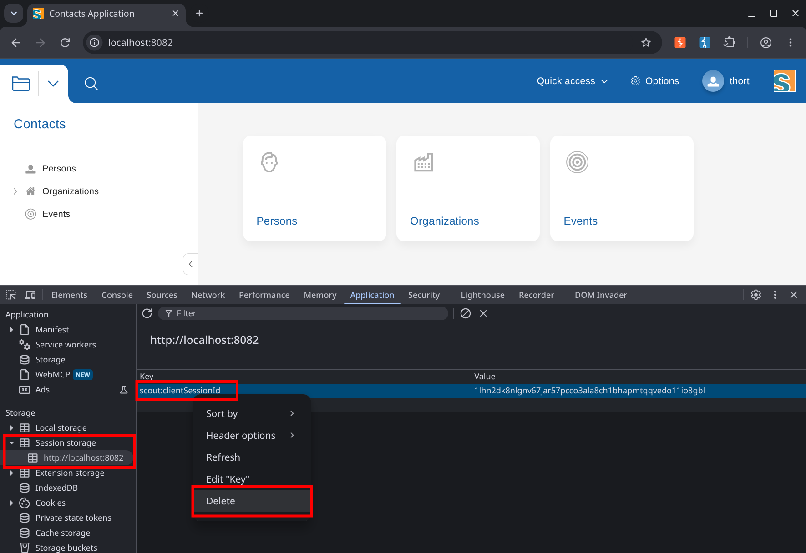

### 2. Perform the action you want to test

Click through the application to perform the action. In this example, we add a new person with
first name *Alice* and last name *Cooper*.

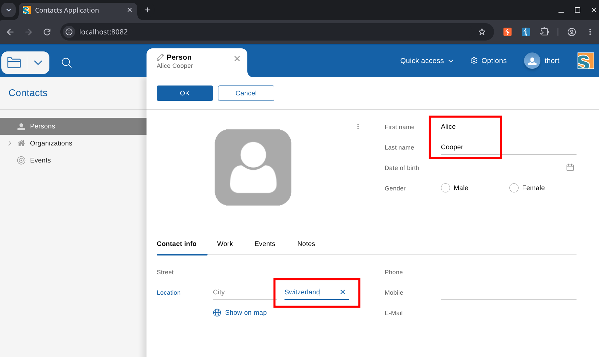

### 3. Send the requests to the extension

In *Proxy → HTTP history*, find the startup request. The extension highlights it in grey
automatically. Select it and every request after it, then right-click and choose
**Extensions → Eclipse Scout → New sequence**. The new sequence is automatically sorted by the response `#`
(`Res#`).

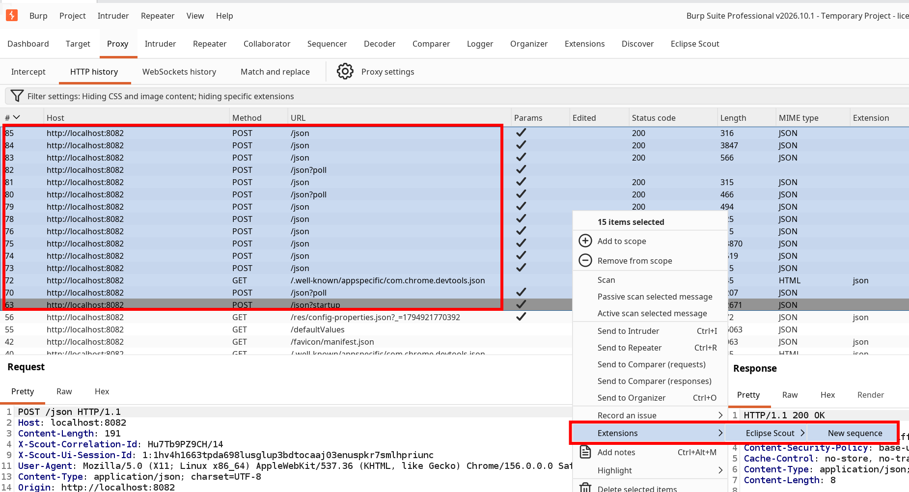

### 4. Clean up the sequence

Switch to the *Eclipse Scout* tab. Some rows are highlighted in yellow. These are either requests
without a Scout `#` sequence number, which are probably unnecessary, or `?poll` requests that
returned no events. They can very likely be removed: select them and press `Delete`.

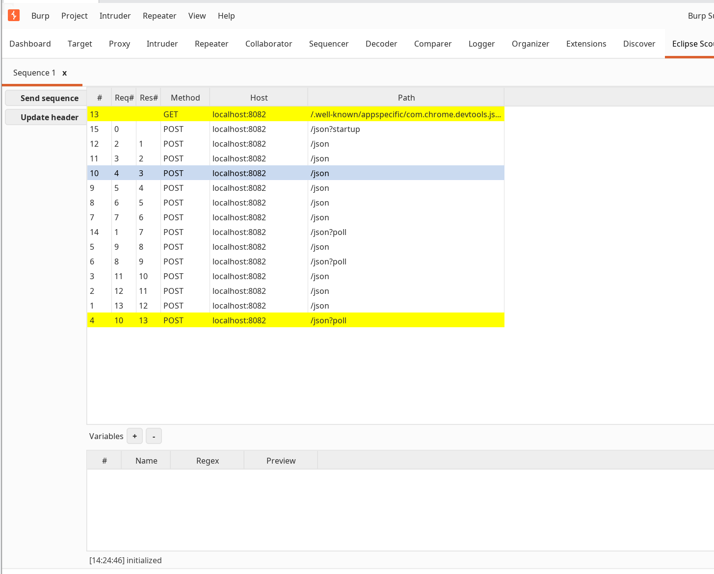

The sequence table has these columns:

| Column                   | Meaning                                                    |
|--------------------------|------------------------------------------------------------|
| `#`                      | Static row id, used to refer to a row (variables, headers) |
| `Req#`                   | `#` sequence number found in the captured request body     |
| `Res#`                   | `#` sequence number found in the captured response body    |
| `Method`, `Host`, `Path` | From the captured request                                  |

You can also reorder rows by dragging and dropping them, edit a request directly in the editor
below the table, and rename the sequence by double-clicking its tab. Reordering should no be
necessary though, it should alredy be correctly sorted.

### 5. Test the sequence as it is

Before changing anything, check that the unmodified sequence replays correctly. Click
**Send sequence**.

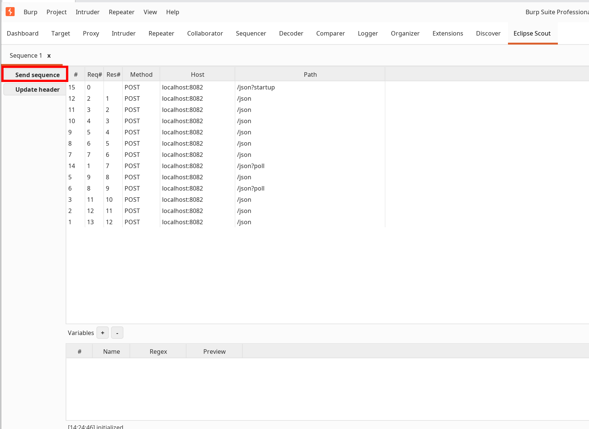

This opens a new *Run N* tab. It shows each replayed request and response as the run progresses,
so you can check that the sequence was sent correctly.

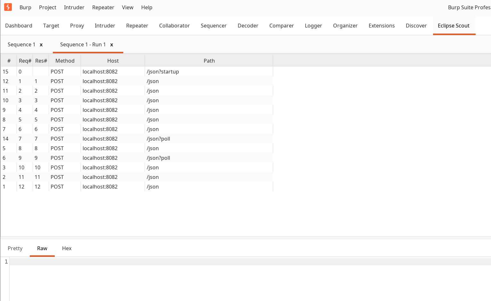

The application should now list *Alice Cooper* twice: the person you created by hand and the one
the replay created.

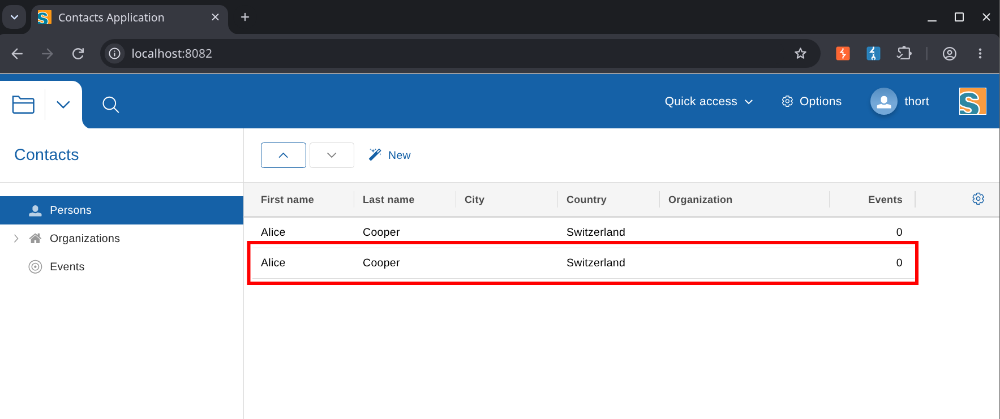

### 6. Send the interesting request to Intruder

Go back to the sequence tab and find the request you want to attack. Here, it's the request that
sets the last name (*Cooper*). Select it and send it to Intruder (right-click → *Send to Intruder*,
or `Ctrl+I`).

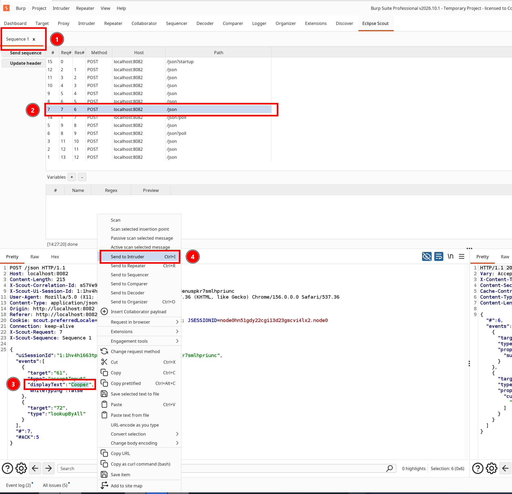

### 7. Run the attack

In Intruder, set payload positions and load payloads as usual, then start the attack. For each
payload, the extension replays the whole sequence in a new UI session. It sends the payload
request in place of its row, then replays the remaining rows.

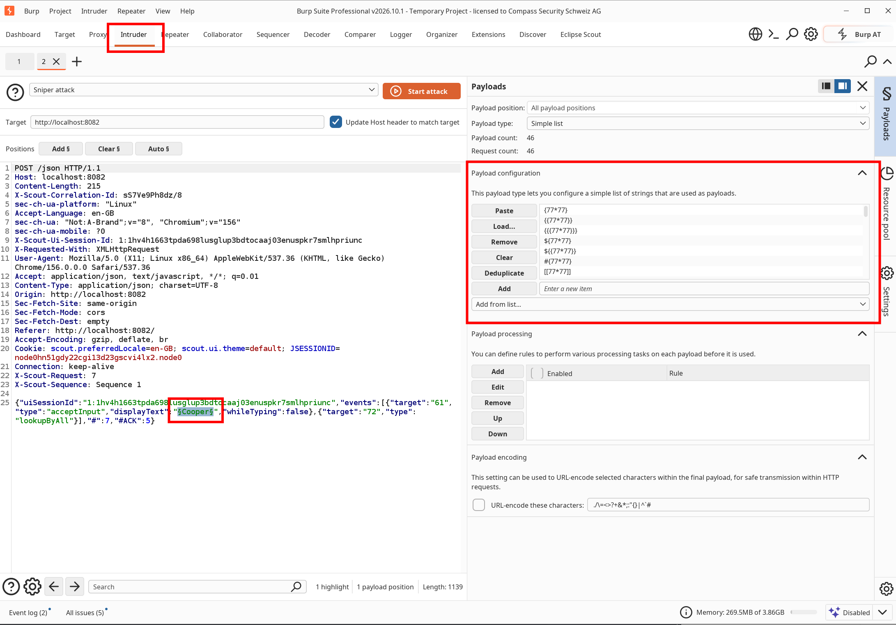

Check the results either in Intruder's attack window or in the application itself.

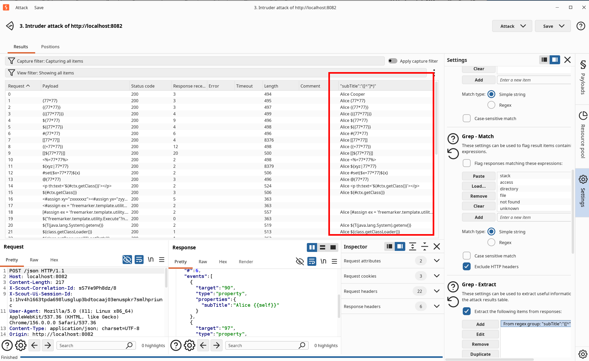

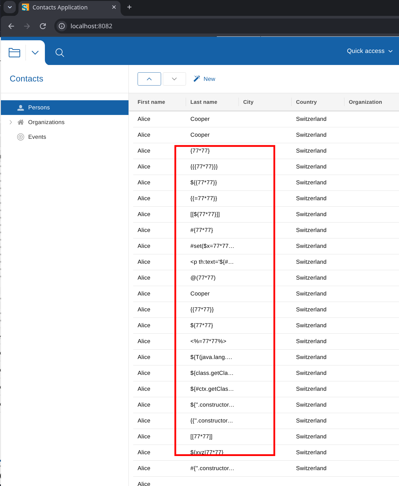

### 8. Show a later response with `X-Scout-Response`

By default, Repeater and Intruder show the response to the request they sent. In Scout, this is
often not the interesting one. To see a later response instead, add an `X-Scout-Response` header to the request in Repeater or
Intruder. Set it to the `#` of the row whose response you want to see:

```http
POST /json HTTP/1.1
Host: scout.example
X-Scout-Sequence: Sequence 1
X-Scout-Request: 12
X-Scout-Response: 15
...
```

Here, row 12 sets the last name and row 15 is the *Save* click. The extension still sends your
request as row 12 and replays the rest of the sequence. Once the run is finished, it hands row 15's
replayed response back to Repeater or Intruder. You can then use Intruder's grep, length and status
columns on the response that actually shows the result.

All three headers are only for routing inside the extension. They are removed before a request is
sent to the server:

| Header             | Added by        | Meaning                                                      |
|--------------------|-----------------|--------------------------------------------------------------|
| `X-Scout-Sequence` | the extension   | Name of the sequence the request belongs to                  |
| `X-Scout-Request`  | the extension   | `#` of the row this request stands in for                    |
| `X-Scout-Response` | you, optionally | `#` of the row whose replayed response should be shown       |

### Variables

In the *Variables* table of a sequence:

1. Select the row whose **response** holds the value and click **+**. This adds a variable with
   `#` set to that row. Fill in `Name` and `Regex`. While editing the regex, right-click and
   choose *Patterns* to insert common building blocks such as `([^"]+)`. The `Preview` column
   shows what the regex matches in the captured response.
2. In a later request, right-click in the request editor and choose **Variables → name** to
   insert `$VAR:name$`, or type the placeholder by hand.

During replay, the value is re-extracted from that row's replayed response. The placeholder is
then replaced in every following request.

## License

[MIT](LICENSE)
